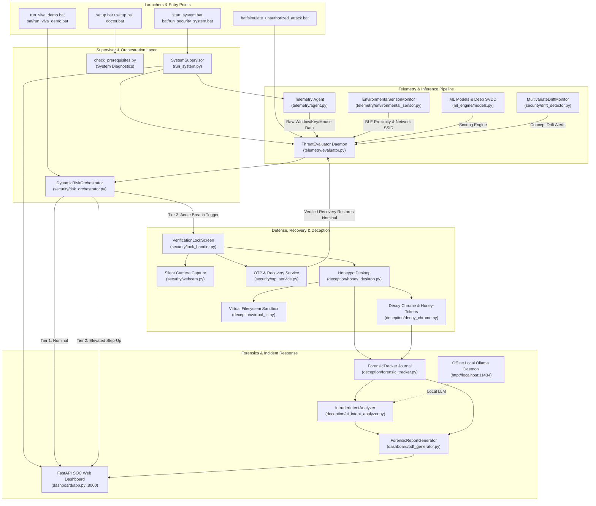

# Pipeline Dependency Map & Execution Architecture

**Project:** Behavioral Drift — Continuous Authentication & Honeypot Forensics  
**Department:** Department of Information Science and Engineering, NMAMIT  
**Audit Date:** 2026-10-11  
**Architecture Standard:** Blue-Team Defensive System Integration

---

## 1. System Execution Pipelines

The system is structured around four primary operational pipelines:

1. **Continuous Defense & Supervision Pipeline (`start_system.bat` / `run_system.py`)**
2. **Academic Defense & Viva Demonstration Pipeline (`run_viva_demo.bat` / `demo_viva_runner.py`)**
3. **Dataset Harvesting & Model Calibration Pipeline (`bat/train_models.bat` / `bat/bootstrap_dataset.bat`)**
4. **Intrusion Simulation & Containment Test Pipeline (`bat/simulate_unauthorized_attack.bat`)**

---

## 2. Component Dependency Graph

---

## 3. Detailed Data Flow Contracts

### Pipeline A: Live Telemetry & Threat Evaluation
1. **Producer:** `telemetry/agent.py` hooks global keyboard and mouse events using `pynput` with zero input lag.
2. **Buffer:** Aggregates timing metrics into sliding 5-second observation windows.
3. **Consumer:** `telemetry/evaluator.py` ingests the observation dictionary:
   - Dwell time (mean, std)
   - Flight time (mean, std)
   - Mouse kinematics (velocity, acceleration, jerk, straightness)
   - Application context (process category, active window, CPU, RAM)
4. **Scoring Pipeline:**
   - Keystroke 1D-CNN Deep SVDD generates sequence anomaly score.
   - One-Class SVM scores continuous timing dynamics.
   - Isolation Forest scores system context and kinematics.
   - Passive BLE monitor contributes log-distance path-loss proximity penalty.
   - Dynamic Modality-Aware Fusion computes instantaneous fused risk $\in [0, 1]$.
   - 3-window sliding temporal smoother filters transient typing bursts.
   - ADWIN monitors multivariate statistical shift across active channels.

### Pipeline B: 3-Tier Policy & Containment
1. **Tier 1 (Nominal, Risk < 0.40):** Zero user friction, silent continuous monitoring.
2. **Tier 2 (Elevated, 0.40 $\le$ Risk < 0.75):** Non-blocking step-up MFA challenge notification; user workflow continues uninterrupted.
3. **Tier 3 (Breach Lockdown, Risk $\ge$ 0.75):**
   - Workstation contained via `VerificationLockScreen`.
   - Silent webcam capture records high-resolution photo with Haar face detection bounding box.
   - Cryptographically random 6-digit OTP generated with 5-minute TTL (`models/.active_otp`).
   - If unauthorized user attempts to dismiss lock or click desktop, user is diverted into sandboxed `HoneypotDesktop`.

### Pipeline C: Honeypot Deception & Sandboxing
1. **Host Isolation:** Real Windows filesystem is protected. File operations in Honey Desktop and HoneyShell are redirected to `data/sandbox/` through `VirtualFileSystem`.
2. **Decoy Portals:**
   - NetBanking portal traps banking credentials.
   - Decoy AWS console serves honey-token access keys (`AKIA5HONEYPOT7X92Q0`).
   - Decoy GitHub repository serves honey-tokens and canary configurations.
3. **Command Filtering:** HoneyShell interprets commands via virtual cmdlets (`dir`, `cat`, `ping`, `arp`, `curl`); commands do not execute on the host Windows command processor.
4. **Audit Journal:** Every action is dispatched to `ForensicTracker`, generating structured JSONL records in `data/forensics/honeypot_events.jsonl` with ISO-8601 timestamps and sequential event IDs.

### Pipeline D: Post-Incident Forensic Reconstruction & AI Profiling
1. **Trigger:** Initiated upon legitimate owner recovery via verified OTP or through automated demonstration runner.
2. **Offline AI Intent Analysis:**
   - `ai_intent_analyzer.py` queries local Ollama daemon (`http://localhost:11434`) using structured JSON prompt.
   - System prompt configures DFIR Computer Crime Investigation Team role.
   - Models evaluated in order of latency: `qwen2.5:3b`, `qwen2.5:1.5b`, `qwen3.5:4b`, `deepseek-r1:1.5b`.
   - If Ollama is offline or times out, the deterministic heuristic rule engine immediately outputs an authoritative report with zero evidence loss.
3. **Forensic PDF Compilation:**
   - `dashboard/pdf_generator.py` aggregates intruder webcam photos, chronological timeline, trapped credentials, and AI attribution narrative.
   - Emits a multi-page PDF sealed with SHA-256 integrity hash in `data/forensics/`.
